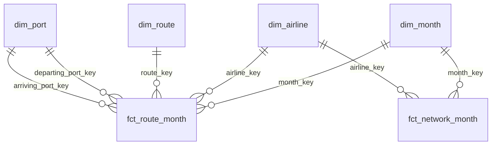

# Airline on-time warehouse (dbt-core + DuckDB)

A small, tested **star-schema warehouse** for Australian domestic airline punctuality, built with **dbt-core** on **DuckDB** from the federal government's open data. It's meant to be the trusted layer a BI team (Power BI, Tableau, a notebook) can connect to without re-learning the source's traps.

> **Status: in progress, Part 2 of 5 done** (source and staging; star schema). Next come the metrics and the business answers. See the [plan](#plan).

## The business question

A corporate travel team books thousands of domestic flights a year, and an airport or tourism body watches route performance. Both ask the same things:

- **Which airlines and routes actually run on time, and which cancel the most?**
- **Has reliability recovered since COVID, and where is it still worst?**
- **What does that mean for booking policy** (preferred carriers, buffer time on connections, which routes to avoid for same-day meetings)?

Answering that in a dashboard sounds easy: the data is public and monthly. The catch is the file itself, and that's the case for a modelled warehouse rather than a CSV dropped into a report.

## What Part 1 found: the raw file double counts

The government file stacks **four grains in one table**: each airline on each route, all airlines on each route, each airline's whole network, and the national total. Full detail is in [`results/SOURCE_PROFILE.md`](results/SOURCE_PROFILE.md) (generated, not hand-written).

| If a report sums `Sectors_Scheduled`… | Flights, Jan 2004 – Sep 2026 | vs the real national total |
|---|---|---|
| over every row of the raw file | 40,359,003 | **3.51×** |
| over the national rows only (correct) | 11,495,634.50 | 1.00× |
| over the detailed route rows only | 8,681,901 | **0.76×** |

- **A naive `SUM` card overstates national flights 3.51×.** Summing the detailed rows understates it instead: BITRE lists only competitive routes with 8,000+ passengers a month, and those carry 76% of national flights. So national and airline totals must come from the network rows, and route analysis from the route rows. One table can't do both safely.
- **The published subtotals don't always add up.** Route totals equal the sum of their airline rows in 30,592 of 30,603 route-months. The national row equals the sum of airline networks in 268 of 273 months. In 4 of the 5 exceptions, a newly reporting airline (Skytrans, Hinterland) was left out of the industry total for its first months.
- **Smaller defects are flagged, not hidden:** 316 route rows with no cancellation count (Qantas Group, 2006–07), 56 rows with fractional flight counts (2009, 2011), a few dozen rows where flown ≠ on time + delayed, and spelling variants of airline names (`virgin Australia`, `Macair`).

**So what for the business:** a dashboard built on the raw file would report three and a half times the real flight volume, and its route totals wouldn't reconcile with its national totals. The warehouse fixes this once, in tested SQL, so every report downstream gets the same answer.

## What Part 2 built: a star schema with one grain per fact

The four stacked grains become **two fact tables at their own grain** plus four shared dimensions, so no table mixes grains and every measure can be summed safely. Full detail, all generated from the build, is in [`results/STAR_SCHEMA.md`](results/STAR_SCHEMA.md).



| Table | One row per… | Rows | Use it for |
|---|---|---|---|
| `fct_route_month` | airline × directional route × month | 87,176 | route and airport analysis (the listed competitive routes) |
| `fct_network_month` | airline × month (whole network) | 1,918 | airline and national totals |
| `dim_airline` | airline, with `brand_family` for renames | 17 | carrier comparisons, long trends |
| `dim_route` | directional route, with city pair, intrastate and capital-to-capital flags | 162 | route slicing; 81 city pairs |
| `dim_port` | port, with state and IATA code; used twice (departing, arriving) | 45 | airport and state views |
| `dim_month` | month, with Australian financial year (Jul–Jun) | 273 | calendar and FY reporting |

Design decisions, each one tested:

- **Route totals are rebuilt, not loaded.** "All airlines on a route" is a `SUM` over `fct_route_month`, so a route total always equals its airline breakdown. BITRE's own route totals disagree with their airline rows in 11 of 30,603 route-months; those stay in staging as a warning.
- **The national total is the sum of the airline networks**, not BITRE's published national row. BITRE defines the industry total as all services of the reporting airlines, yet in 4 of 5 mismatching months the published row leaves out a newly reporting airline's whole network (Skytrans May 2023, Hinterland Mar–May 2024; Mar 2006 matches no single airline). The difference is at most **2.4% of flights and 0.19 points of on-time rate** (`audit_national_total` shows every month side by side). Summing the airline rows also means a dashboard's grand total always equals the sum of its airline bars. A dbt test fails the build if a future release opens a gap over 3% or moves the on-time rate by more than 0.5 points, so the decision gets revisited, not silently carried on.
- **Renamed airlines keep their own rows, linked by `brand_family` with evidence.** Skywest and *Virgin Australia – ATR/F100 Operations* → *Virgin Australia Regional Airlines* (May 2013) comes from BITRE's [notes on the data](https://data.gov.au/data/dataset/domestic-airline-on-time-performance). Regional Express → Rex Airlines (Jul 2021) is inferred from the data: the same 30 routes are listed in the last month of one and the first month of the other. Skytrans and Skytrans Australia are **not** linked: there's a six-month gap and no published source.
- **Readable, stable keys** for BI tools: `yyyymm` months, IATA route keys (`SYD-MEL`), port codes, airline slugs. They don't change when a rebuild adds a new airline or month.
- **Nothing lost or double counted:** a test compares row counts and five measure totals per month between staging and each fact; others check every key against its dimension, the declared grain of each fact, that each route and its reverse share one city pair, and that an airline's routes never exceed its network.

**So what for the business:** a travel manager can now ask "how did Qantas, Jetstar and Virgin Australia compare on Sydney–Melbourne in FY2025-26?" or "which Queensland airports have the most cancellations on the listed routes?" with plain joins and sums, and get numbers that reconcile with the airline and national totals. Part 4 exports the same tables for a Power BI model, so the dashboard inherits these rules instead of re-implementing them in DAX.

## How it's built

```
data.gov.au CSV ──► data/snapshots/*.csv.gz ──► dbt source ──► staging ──► dims + facts ──► (Part 3) metrics ──► Power BI / notebooks
                    pinned, SHA-256             read as        typed,      one grain
                    checked                     text           grain       per fact
                                                               labelled
```

| Layer | What it does | Where |
|---|---|---|
| Snapshot | The monthly CSV, gzipped deterministically (1.6 MB) with its SHA-256, licence and row count in `SNAPSHOT.json`. data.gov.au replaces the file in place every month, so the snapshot keeps the build reproducible; older snapshots live in git history. | [`data/snapshots/`](data/snapshots), [`scripts/download_data.py`](scripts/download_data.py) |
| Source | dbt-duckdb reads the gzip directly; every column as text so typing happens in one place. | [`_bitre__sources.yml`](warehouse/models/staging/_bitre__sources.yml) |
| Staging | `stg_bitre__otp_monthly`: one row per source row, typed, airline names cleaned through a seed, `row_grain` label, defect flags. Nothing dropped or "fixed". | [`stg_bitre__otp_monthly.sql`](warehouse/models/staging/stg_bitre__otp_monthly.sql), [`airline_names.csv`](warehouse/seeds/airline_names.csv) |
| Star schema | Two facts (`fct_route_month`, `fct_network_month`), four dimensions, and `audit_national_total` documenting the national-total choice. Seeds hold the port list (state, IATA code) and airline brand lineage with sources. | [`models/marts/`](warehouse/models/marts), [`models/audit/`](warehouse/models/audit), [`ports.csv`](warehouse/seeds/ports.csv), [`airline_brands.csv`](warehouse/seeds/airline_brands.csv) |
| Tests | 123 dbt tests. **Structural rules fail the build:** unique keys and grains, every fact key in its dimension, facts conserve staging's rows and totals, "All Ports" on both ends or neither, no missing months, route names match ports, cleaned names don't merge two rows, routes within networks, city pairs, the national-total gap bound. **Known source defects warn** (6) and are counted in the profile. Plus 30 pytest tests, including a full rebuild that fails if either committed report is stale. | [`warehouse/tests/`](warehouse/tests), [`tests/`](tests) |

Every model is materialised as a table, not a view, so the `.duckdb` file is self-contained and any client can open it from any folder.

## Data

**Source:** Bureau of Infrastructure and Transport Research Economics (BITRE), [*Domestic Airlines – On Time Performance*](https://data.gov.au/data/dataset/domestic-airline-on-time-performance), data.gov.au. Licence: [Creative Commons Attribution 3.0 Australia](http://creativecommons.org/licenses/by/3.0/au/). Snapshot published 2026-10-22: 119,970 rows, January 2004 to September 2026.

BITRE's definitions: a flight is **on time** if it arrives at (or departs) the gate less than 15 minutes after schedule. A **cancellation** is a flight removed from service within 7 days of departure. Diverted and cancelled flights are never on time. The published routes are those averaging 8,000+ passengers a month with two or more competing airlines.

## How to run

```bash
uv venv && source .venv/bin/activate     # or: python -m venv .venv
pip install -r requirements.txt           # dbt-core 1.x, dbt-duckdb, duckdb, pytest

python scripts/build.py                   # verify snapshot, then dbt build -> data/warehouse.duckdb
python scripts/profile_source.py          # -> results/SOURCE_PROFILE.md
python scripts/describe_schema.py         # -> results/STAR_SCHEMA.md
pytest                                    # 30 tests (rebuilds the warehouse in a temp folder)

python scripts/download_data.py --check   # has BITRE published a newer month?
python scripts/download_data.py --update  # snapshot it, then rebuild
```

Or run dbt directly: `cd warehouse && dbt build`. The profile in `warehouse/profiles.yml` points at `data/warehouse.duckdb`; no server, account or sign-up is needed. dbt-core 1.x is the Apache-2.0 engine; this project doesn't use dbt v2.

## Plan

1. ✅ **Source, staging, profile.** Snapshot + download script, dbt source, typed and grain-labelled staging, 42 dbt tests, generated source profile.
2. ✅ **Star schema.** `dim_airline` (brand history with sources), `dim_port` (role-played, with state), `dim_route` (with city pairs), `dim_month` (with Australian FY); `fct_route_month` and `fct_network_month` at their own grains; national total = sum of airline networks, documented in `audit_national_total`; 81 new dbt tests and 21 pytest tests.
3. **Metrics and analysis.** Tested metric definitions (on-time rate = on-time ÷ flown, as a ratio of sums, not an average of ratios), then the business answers with charts: reliability by airline and route, the post-COVID recovery and the worst routes.
4. **Power BI loading guide.** Export to Parquet, relationships (including the role-playing port dimension), DAX measures matching the dbt metrics, and a build checklist. The `.pbix` gets built on Windows.
5. **CI and write-up.** GitHub Actions runs `dbt build` and `pytest` on every push; final README with recommendations and limitations.

## Repo layout

```
data/snapshots/        committed source snapshot + SNAPSHOT.json
scripts/               download_data.py, build.py, profile_source.py, describe_schema.py
warehouse/             the dbt project: models/staging, models/marts, models/audit, seeds/, tests/
results/               generated reports
tests/                 pytest
```
