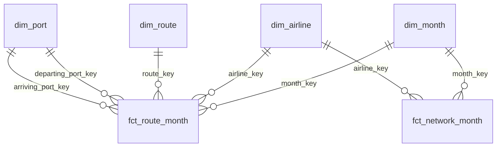

# Airline on-time warehouse (dbt-core + DuckDB)

[](https://github.com/nisha1324/airline-ontime-dbt-warehouse/actions/workflows/ci.yml)

A small, tested **star-schema warehouse** for Australian domestic airline punctuality, built with **dbt-core** on **DuckDB** from the federal government's open data. It's meant to be the trusted layer a BI team (Power BI, Tableau, a notebook) can connect to without re-learning the source's traps.

> **Status: complete** (all 5 parts: source and staging; star schema; metrics and business answers; Power BI model and guide; CI). The one open step needs Windows: building the `.pbix` from [`powerbi/POWERBI_GUIDE.md`](powerbi/POWERBI_GUIDE.md) and confirming it against [`powerbi/CHECKS.md`](powerbi/CHECKS.md). See the [limitations](#limitations).

## TL;DR

- **The raw government file can't be summed safely.** It stacks four grains in one table, so a naive `SUM` overstates national flights **3.51×**. The warehouse splits it into two fact tables at their own grain plus four shared dimensions, and 166 dbt tests and 55 pytest tests guard the rules. GitHub Actions reruns all of it on every push.
- **Punctuality hasn't recovered.** 77.9% of flights arrived on time in the latest 12 months (Oct 2025 – Sep 2026), vs 79.4% in FY2018-19 and 82.2% over the 15 years before COVID. Cancellations have mostly recovered: 1.92%, vs 2.05% in FY2018-19.
- **On busy routes, the airline matters more than the route.** On the 5 busiest city pairs, airlines on the same route are 4.9 to 29.1 points apart, while the routes themselves are within 3.2 points. On Brisbane–Melbourne, Qantas ran 88.4% on time and Jetstar 59.3%.
- **The worst routes are consistently bad, and late isn't the same as cancelled.** Launceston–Melbourne (68.0%) and Melbourne–Mildura ran below the national rate in 12 of 12 months. Canberra–Sydney is 9th of 40 for punctuality but cancels the most (4.99%).
- **A Power BI model that can be checked.** 7 Parquet files, 31 DAX measures written to the dbt rules, and 7 check queries with expected answers. The cancellation trap they catch: a plain `DIVIDE` gives Jetstar's FY2006-07 route cancellation rate as 0.46% instead of 0.57%.

## The business question

A corporate travel team books thousands of domestic flights a year, and an airport or tourism body watches route performance. Both ask the same things:

- **Which airlines and routes actually run on time, and which cancel the most?**
- **Has reliability recovered since COVID, and where is it still worst?**
- **What does that mean for booking policy** (preferred carriers, buffer time on connections, which routes to avoid for same-day meetings)?

Answering that in a dashboard sounds easy: the data is public and monthly. The catch is the file itself, and that's the case for a modelled warehouse rather than a CSV dropped into a report.

## What Part 1 found: the raw file double counts

The government file stacks **four grains in one table**: each airline on each route, all airlines on each route, each airline's whole network, and the national total. Full detail is in [`results/SOURCE_PROFILE.md`](results/SOURCE_PROFILE.md) (generated, not hand-written).

| If a report sums `Sectors_Scheduled`… | Flights, Jan 2004 – Sep 2026 | vs the real national total |
|---|---|---|
| over every row of the raw file | 40,359,003 | **3.51×** |
| over the national rows only (correct) | 11,495,634.50 | 1.00× |
| over the detailed route rows only | 8,681,901 | **0.76×** |

- **A naive `SUM` card overstates national flights 3.51×.** Summing the detailed rows understates it instead: BITRE lists only competitive routes with 8,000+ passengers a month, and those carry 76% of national flights. So national and airline totals must come from the network rows, and route analysis from the route rows. One table can't do both safely.
- **The published subtotals don't always add up.** Route totals equal the sum of their airline rows in 30,592 of 30,603 route-months. The national row equals the sum of airline networks in 268 of 273 months. In 4 of the 5 exceptions, a newly reporting airline (Skytrans, Hinterland) was left out of the industry total for its first months.
- **Smaller defects are flagged, not hidden:** 316 route rows with no cancellation count (Qantas Group, 2006–07), 56 rows with fractional flight counts (2009, 2011), a few dozen rows where flown ≠ on time + delayed, and spelling variants of airline names (`virgin Australia`, `Macair`).

**So what for the business:** a dashboard built on the raw file would report three and a half times the real flight volume, and its route totals wouldn't reconcile with its national totals. The warehouse fixes this once, in tested SQL, so every report downstream gets the same answer.

## What Part 2 built: a star schema with one grain per fact

The four stacked grains become **two fact tables at their own grain** plus four shared dimensions, so no table mixes grains and every measure can be summed safely. Full detail, all generated from the build, is in [`results/STAR_SCHEMA.md`](results/STAR_SCHEMA.md).



| Table | One row per… | Rows | Use it for |
|---|---|---|---|
| `fct_route_month` | airline × directional route × month | 87,176 | route and airport analysis (the listed competitive routes) |
| `fct_network_month` | airline × month (whole network) | 1,918 | airline and national totals |
| `dim_airline` | airline, with `brand_family` for renames | 17 | carrier comparisons, long trends |
| `dim_route` | directional route, with city pair, intrastate and capital-to-capital flags | 162 | route slicing; 81 city pairs |
| `dim_port` | port, with state and IATA code; used twice (departing, arriving) | 45 | airport and state views |
| `dim_month` | month, with Australian financial year (Jul–Jun) | 273 | calendar and FY reporting |

Design decisions, each one tested:

- **Route totals are rebuilt, not loaded.** "All airlines on a route" is a `SUM` over `fct_route_month`, so a route total always equals its airline breakdown. BITRE's own route totals disagree with their airline rows in 11 of 30,603 route-months; those stay in staging as a warning.
- **The national total is the sum of the airline networks**, not BITRE's published national row. BITRE defines the industry total as all services of the reporting airlines, yet in 4 of 5 mismatching months the published row leaves out a newly reporting airline's whole network (Skytrans May 2023, Hinterland Mar–May 2024; Mar 2006 matches no single airline). The difference is at most **2.4% of flights and 0.19 points of on-time rate** (`audit_national_total` shows every month side by side). Summing the airline rows also means a dashboard's grand total always equals the sum of its airline bars. A dbt test fails the build if a future release opens a gap over 3% or moves the on-time rate by more than 0.5 points, so the decision gets revisited, not silently carried on.
- **Renamed airlines keep their own rows, linked by `brand_family` with evidence.** Skywest and *Virgin Australia – ATR/F100 Operations* → *Virgin Australia Regional Airlines* (May 2013) comes from BITRE's [notes on the data](https://data.gov.au/data/dataset/domestic-airline-on-time-performance). Regional Express → Rex Airlines (Jul 2021) is inferred from the data: the same 30 routes are listed in the last month of one and the first month of the other. Skytrans and Skytrans Australia are **not** linked: there's a six-month gap and no published source.
- **Readable, stable keys** for BI tools: `yyyymm` months, IATA route keys (`SYD-MEL`), port codes, airline slugs. They don't change when a rebuild adds a new airline or month.
- **Nothing lost or double counted:** a test compares row counts and five measure totals per month between staging and each fact; others check every key against its dimension, the declared grain of each fact, that each route and its reverse share one city pair, and that an airline's routes never exceed its network.

**So what for the business:** a travel manager can now ask "how did Qantas, Jetstar and Virgin Australia compare on Sydney–Melbourne in FY2025-26?" or "which Queensland airports have the most cancellations on the listed routes?" with plain joins and sums, and get numbers that reconcile with the airline and national totals. Part 4 exports the same tables for a Power BI model, so the dashboard inherits these rules instead of re-implementing them in DAX.

## What Part 3 found: punctuality hasn't recovered, and on the busiest routes the airline matters more than the route

A tested **metrics layer** sits on the star schema: the three rates are defined once (a dbt macro, as ratios of sums) and reused by five metric models covering national, airline, route, airline-on-route and airport, each compared over three windows: FY2004-05 to FY2018-19, FY2018-19 and the latest 12 months (Oct 2025 to Sep 2026). League tables only rank routes, airports and airlines-on-routes averaging at least 300 scheduled flights a month (about 10 a day). Every figure below comes from the generated [`results/METRICS.md`](results/METRICS.md), which has the full tables.


- **Punctuality is still below pre-COVID.** 77.9% of flights arrived on time in the latest 12 months, vs 79.4% in FY2018-19 and 82.2% over the 15 years before COVID. It has climbed back from the worst 12 months in the series (67.5%, to Mar 2023).
- **Cancellations have mostly recovered:** 1.92%, below FY2018-19 (2.05%) but above the long-run 1.50%. They peaked at 11.08% in the 12 months to Oct 2021.
- **All 5 major airlines are less punctual than in FY2018-19.** Rex fell furthest (80.5% → 72.6%), and QantasLink and Rex now cancel more than they did then. Network figures mix in where each airline flies, though, so the fair test is the same route:


- **On the 5 busiest city pairs, the gap between airlines on the same route (4.9 to 29.1 points) is bigger than the gap between the routes (3.2 points).** Brisbane–Melbourne: Qantas 88.4%, Virgin Australia 72.1%, Jetstar 59.3%. Qantas was the most punctual airline on 4 of the 5; on Gold Coast–Sydney it was below the volume floor.
- **Worst routes:** Launceston–Melbourne (68.0%), Melbourne–Mildura (69.8%) and Hobart–Melbourne (71.5%) ran below the national rate in **12 of 12 months**, so it's not one bad month. Best: Brisbane–Gladstone (85.7%) and Brisbane–Mackay (85.3%).
- **Late and cancelled are different problems** (rank correlation −0.15). Canberra–Sydney is 9th of 40 for punctuality but cancels the most: 4.99%, about 1 flight in 20. Melbourne–Sydney, the busiest pair, cancels 3.67%.
- **29 of 38 routes** ranked in both periods are less punctual than in FY2018-19; the biggest falls are regional (Adelaide–Port Lincoln −11.5 points, Melbourne–Mildura −10.8).
- **Airports:** the least punctual departure points are Sunshine Coast (69.5% on time) and Launceston (70.3%); among the big four, Melbourne (75.3%) and Sydney (76.5%) trail Brisbane (79.6%) and Perth (82.7%).

**So what for a corporate travel team:**

1. **Set the preferred carrier route by route, not network-wide.** On Brisbane–Melbourne the choice of airline is worth 29 points of punctuality; on Melbourne–Sydney it's 6.5. `met_city_pair_brand_period` gives the ranking for every listed route. The data has no fares, so the trade-off against price is the team's call.
2. **Budget for lateness.** More than 1 flight in 5 isn't on time nationally (it arrives 15+ minutes late or is diverted), and about 3 in 10 aren't on the worst routes (Launceston, Mildura and Hobart to and from Melbourne). Leave a buffer before meetings and connections, or book an earlier flight.
3. **Treat cancellation-prone routes separately.** On Canberra–Sydney (1 in 20 cancelled), don't book the last flight of the day for must-attend events. A good on-time record doesn't protect against that.
4. **Benchmark against today, not 2019.** A supplier review that expects pre-COVID punctuality will mark every major airline down. Compare airlines with each other on the same routes, and track the rolling 12-month trend from `met_national_month`.

Caveats: on time means within 15 minutes of schedule (BITRE's definition), so it says nothing about longer delays. Route and airport figures cover only the listed competitive routes (about three quarters of flights). The floor-sensitivity check in the report shows which routes join the rankings at a lower floor (e.g. Hamilton Island–Sydney, 64.5% on time on 1,474 flights).

## What Part 4 built: a Power BI model that matches the warehouse

Power BI Desktop only runs on Windows, so this part prepares everything the report needs and a step-by-step guide; the `.pbix` itself gets built on a Windows machine. Everything is in [`powerbi/`](powerbi), and the guide is [`powerbi/POWERBI_GUIDE.md`](powerbi/POWERBI_GUIDE.md).

- **The star schema as Parquet** (7 files, 2.5 MB, committed so no Python is needed on Windows). Power Query reads them with `Parquet.Document`. The export reads each file back and checks its row count, schema, null counts and column totals against the warehouse, and stops if anything differs; [`MANIFEST.json`](powerbi/data/MANIFEST.json) records those figures.
- **The model:** seven single-direction relationships. The port dimension is loaded twice (`Departing Port`, `Arriving Port`), so both roles can be sliced without `USERELATIONSHIP`. `dim_month` isn't marked as a date table (it has one row per month, not per day), and `dim_comparison_period` stays disconnected because its windows overlap.
- **31 DAX measures** in [`measures.dax`](powerbi/measures.dax), written to the same rules as the dbt macro: ratio-of-sums rates, airline and national figures from the network fact only, a cancellation base that leaves out rows with no count (`ISBLANK`, since `0 = BLANK()` is true in DAX), rolling 12-month rates and period measures, and the same 300-flights-a-month floor for league tables. Paste the file into DAX query view and one click adds them all.
- **Check values** in [`CHECKS.md`](powerbi/CHECKS.md): 7 queries at the end of `measures.dax`, with the answers Power BI should return (to two decimal places). Each answer is computed from the Parquet files with the DAX's logic, and a test checks it against the dbt metrics models.

The traps this guards against are real. The clearest is in the check values: in FY2006-07, a plain `DIVIDE(SUM(cancellations), SUM(sectors_scheduled))` reports Jetstar's route cancellation rate as **0.46%**, but the correct figure is **0.57%**. The plain version treats 141 rows with no cancellation count as "nothing cancelled", which understates the rate by about a fifth.

What isn't done yet: the DAX hasn't been run inside Power BI, because there's no Windows machine here. The tests check it statically (every measure it uses is defined, every table and column exists in the export, the floor matches dbt, one check query per section of `CHECKS.md`), and the check queries confirm it on the first build. Report screenshots come after that.

**So what for the business:** the dashboard inherits the warehouse's rules instead of re-implementing them, and anyone can confirm it does in a few minutes, by running the check queries. A travel manager reading "Qantas 88.4% vs Jetstar 59.3% on Brisbane–Melbourne" in Power BI sees the same number as the SQL report, so the booking-policy discussion is about the decision, not about whose figure is right.

## What Part 5 added: CI on every push

[`.github/workflows/ci.yml`](.github/workflows/ci.yml) runs on every push and pull request, in about a minute:

1. Installs the exact package versions from [`requirements-lock.txt`](requirements-lock.txt), the ones the committed outputs were made with. `requirements.txt` keeps the looser ranges for local use.
2. Runs `dbt build`, which first checks the snapshot's SHA-256. Any structural test failure fails the job; the 6 known source defects only warn. The step summary lists the dbt results by status.
3. Reruns every generator from [How to run](#how-to-run) and fails if any committed report, chart, Parquet file or check value changes. The charts are compared byte for byte, which is why the versions are pinned.
4. Runs `pytest`, which rebuilds the warehouse in a temp folder and cross-checks it against staging.

**So what for the business:** when BITRE publishes a new month, refreshing the snapshot is a one-line change, and CI says whether the numbers still reconcile before anyone sees a dashboard. A source change that breaks a rule (a new grain, a national-total gap above the 3% bound, a missing month) turns the badge red instead of reaching a report.

## Recommendations, ranked

For a corporate travel team (the first four) and the data team that runs the warehouse (the last two). The evidence is in [`results/METRICS.md`](results/METRICS.md) and [`results/SOURCE_PROFILE.md`](results/SOURCE_PROFILE.md).

| # | Recommendation | Evidence | Owner |
|---|---|---|---|
| 1 | **Pick the preferred airline route by route, not network-wide.** It's the biggest lever in the data. | On the 5 busiest city pairs, same-route airline gaps of 4.9 to 29.1 points vs 3.2 points between routes; Brisbane–Melbourne: Qantas 88.4%, Jetstar 59.3%. | Travel manager |
| 2 | **Build lateness into travel policy.** Leave a buffer before meetings and connections, or book an earlier flight, especially on the worst routes. | Nationally, 22% of flights flown in the latest 12 months arrived 15+ minutes late or were diverted; on Launceston–Melbourne it's 32%, and that route was below national in 12 of 12 months. | Travel policy owner |
| 3 | **Treat cancellation-prone routes separately.** For must-attend events, don't book the last flight of the day. | Canberra–Sydney cancels 4.99% (about 1 in 20) while ranking 9th of 40 for punctuality; late and cancelled are barely related (rank correlation −0.15). | Travel manager |
| 4 | **Review suppliers against today's peers, not 2019.** Compare airlines on the same routes and track the rolling 12-month trend. | All 5 major brands are less punctual than in FY2018-19, so a 2019 benchmark marks every airline down. | Procurement |
| 5 | **Report from the warehouse, never the raw CSV.** Confirm the Power BI build with the check queries before publishing it. | A naive `SUM` over the raw file is 3.51× the real national flights; a plain `DIVIDE` understates Jetstar's FY2006-07 route cancellations (0.46% vs 0.57%). | BI lead |
| 6 | **Refresh monthly and let CI gate it.** Run `download_data.py --check`, then `--update`, and merge only when CI is green. | data.gov.au replaces the file in place every month; the national-total and conservation tests catch a source change before it reaches a report. | Data engineer |

The data has no fares, so the trade-off between punctuality and price (recommendation 1) is the travel team's call.

## Limitations

- **Listed routes only.** Route and airport figures cover the competitive routes BITRE publishes (8,000+ passengers a month, two or more airlines), about three quarters of national flights. Airline and national figures use the whole networks.
- **"On time" means within 15 minutes** of schedule (BITRE's definition). The data has no delay minutes, delay causes, passenger numbers or fares.
- **Network figures mix route choice into airline performance.** An airline that flies more hard routes looks worse network-wide, so airline comparisons for booking decisions should use the same-route tables.
- **The national total is a choice.** It's the sum of the airline networks, not BITRE's published national row. They differ by at most 2.4% of flights and 0.19 points of on-time rate, and a test fails the build if a future release widens the gap past 3% or 0.5 points.
- **The Rex lineage is inferred** (Regional Express → Rex Airlines, Jul 2021, from identical route lists), not from a published source. Skytrans and Skytrans Australia are deliberately not linked.
- **Known source defects are kept, not fixed:** 316 route rows with no cancellation count (left out of the cancellation rate on both sides), 56 rows with fractional flight counts, and a few dozen rows where flights flown ≠ on time + delayed. They're flagged in staging and counted in the profile.
- **The DAX hasn't run in Power BI yet.** It's checked statically and against expected values, but the first real test is building the `.pbix` on Windows and running the check queries.
- **A snapshot, not a live feed.** The figures are from the snapshot published 2026-10-22 (data to Sep 2026); refreshing it is a one-line command.

## How it's built

```
data.gov.au CSV ──► data/snapshots/*.csv.gz ──► dbt source ──► staging ──► dims + facts ──► metrics ──► reports, charts
                                                                                   └──► Parquet ──► Power BI
                    pinned, SHA-256             read as        typed,      one grain
                    checked                     text           grain       per fact
                                                               labelled
```

| Layer | What it does | Where |
|---|---|---|
| Snapshot | The monthly CSV, gzipped deterministically (1.6 MB) with its SHA-256, licence and row count in `SNAPSHOT.json`. data.gov.au replaces the file in place every month, so the snapshot keeps the build reproducible; older snapshots live in git history. | [`data/snapshots/`](data/snapshots), [`scripts/download_data.py`](scripts/download_data.py) |
| Source | dbt-duckdb reads the gzip directly; every column as text so typing happens in one place. | [`_bitre__sources.yml`](warehouse/models/staging/_bitre__sources.yml) |
| Staging | `stg_bitre__otp_monthly`: one row per source row, typed, airline names cleaned through a seed, `row_grain` label, defect flags. Nothing dropped or "fixed". | [`stg_bitre__otp_monthly.sql`](warehouse/models/staging/stg_bitre__otp_monthly.sql), [`airline_names.csv`](warehouse/seeds/airline_names.csv) |
| Star schema | Two facts (`fct_route_month`, `fct_network_month`), four dimensions, and `audit_national_total` documenting the national-total choice. Seeds hold the port list (state, IATA code) and airline brand lineage with sources. | [`models/marts/`](warehouse/models/marts), [`models/audit/`](warehouse/models/audit), [`ports.csv`](warehouse/seeds/ports.csv), [`airline_brands.csv`](warehouse/seeds/airline_brands.csv) |
| Metrics | `otp_metrics.sql` defines the three rates once, as ratios of sums, with missing cancellation counts left out of both sides. `dim_comparison_period` names the windows. Five `met_*` models keep the summed counts next to the rates, so a BI tool can re-aggregate them, plus an `is_ranked` volume floor (`ranking_min_flights_per_month`). `scripts/analyse.py` turns them into the report and charts. | [`macros/otp_metrics.sql`](warehouse/macros/otp_metrics.sql), [`models/metrics/`](warehouse/models/metrics), [`results/METRICS.md`](results/METRICS.md) |
| Tests | 165 dbt data tests and 1 dbt unit test. **Structural rules fail the build:** unique keys and grains, every fact key in its dimension, facts conserve staging's rows and totals, "All Ports" on both ends or neither, no missing months, route names match ports, cleaned names don't merge two rows, routes within networks, city pairs, the national-total gap bound, every metrics table adds back to its fact in every period, the rolling window is exactly 12 months, and rates stay within 0..1. The unit test feeds hand-worked rows through the city-pair model (ratio of sums vs average of ratios; a missing cancellation count). **Known source defects warn** (6) and are counted in the profile. Plus 55 pytest tests: they recompute rates straight from staging rows, check the Power BI files against the warehouse and the dbt metrics, and a full rebuild fails if any committed report, chart, Parquet file or check value is stale. | [`warehouse/tests/`](warehouse/tests), [`tests/`](tests) |
| Power BI | The star schema exported to Parquet and checked on read-back, a manifest, 31 DAX measures matching the dbt metrics, 7 check queries with expected values, and the build guide. | [`powerbi/`](powerbi), [`export_powerbi.py`](scripts/export_powerbi.py), [`powerbi_checks.py`](scripts/powerbi_checks.py) |
| CI | GitHub Actions on every push: pinned installs, `dbt build`, every generator rerun with a check that no committed file changed, then `pytest`. | [`.github/workflows/ci.yml`](.github/workflows/ci.yml), [`requirements-lock.txt`](requirements-lock.txt) |

Every model is materialised as a table, not a view, so the `.duckdb` file is self-contained and any client can open it from any folder.

## Data

**Source:** Bureau of Infrastructure and Transport Research Economics (BITRE), [*Domestic Airlines – On Time Performance*](https://data.gov.au/data/dataset/domestic-airline-on-time-performance), data.gov.au. Licence: [Creative Commons Attribution 3.0 Australia](http://creativecommons.org/licenses/by/3.0/au/). Snapshot published 2026-10-22: 119,970 rows, January 2004 to September 2026.

BITRE's definitions: a flight is **on time** if it arrives at (or departs) the gate less than 15 minutes after schedule. A **cancellation** is a flight removed from service within 7 days of departure. Diverted and cancelled flights are never on time. The published routes are those averaging 8,000+ passengers a month with two or more competing airlines.

## How to run

```bash
uv venv && source .venv/bin/activate     # or: python -m venv .venv
pip install -r requirements.txt           # dbt-core 1.x, dbt-duckdb, duckdb, pytest
                                          # (or requirements-lock.txt for CI's exact versions)

python scripts/build.py                   # verify snapshot, then dbt build -> data/warehouse.duckdb
python scripts/profile_source.py          # -> results/SOURCE_PROFILE.md
python scripts/describe_schema.py         # -> results/STAR_SCHEMA.md
python scripts/analyse.py                 # -> results/METRICS.md + results/charts/*.png
python scripts/export_powerbi.py          # -> powerbi/data/*.parquet + MANIFEST.json
python scripts/powerbi_checks.py          # -> powerbi/CHECKS.md
pytest                                    # 55 tests (rebuilds the warehouse in a temp folder)

python scripts/download_data.py --check   # has BITRE published a newer month?
python scripts/download_data.py --update  # snapshot it, then rebuild
```

Or run dbt directly: `cd warehouse && dbt build`. The profile in `warehouse/profiles.yml` points at `data/warehouse.duckdb`; no server, account or sign-up is needed. dbt-core 1.x is the Apache-2.0 engine; this project doesn't use dbt v2.

## Plan

1. ✅ **Source, staging, profile.** Snapshot + download script, dbt source, typed and grain-labelled staging, 42 dbt tests, generated source profile.
2. ✅ **Star schema.** `dim_airline` (brand history with sources), `dim_port` (role-played, with state), `dim_route` (with city pairs), `dim_month` (with Australian FY); `fct_route_month` and `fct_network_month` at their own grains; national total = sum of airline networks, documented in `audit_national_total`; 81 new dbt tests and 21 pytest tests.
3. ✅ **Metrics and analysis.** The rates defined once in a macro (ratios of sums), 5 metric models over 3 comparison windows, 42 new dbt data tests and a unit test, 9 new pytest tests; a generated report with 4 charts answering the recovery, airline, route and airport questions.
4. ✅ **Power BI model and guide.** Parquet export checked on read-back, 7 relationships (the port dimension loaded once per role), 31 DAX measures matching the dbt metrics, 7 check queries with tested expected values, a build guide with 4 report pages; 16 new pytest tests. The `.pbix` and screenshots get built on Windows.
5. ✅ **CI and write-up.** GitHub Actions on every push (pinned versions, `dbt build`, a no-changes check after rerunning every generator, `pytest`); TL;DR, ranked recommendations and limitations.

## Repo layout

```
data/snapshots/        committed source snapshot + SNAPSHOT.json
scripts/               download_data.py, build.py, profile_source.py, describe_schema.py, analyse.py,
                       export_powerbi.py, powerbi_checks.py
warehouse/             the dbt project: models/staging, models/marts, models/metrics, models/audit,
                       macros/, seeds/, tests/
results/               generated reports and charts/
powerbi/               Parquet export + manifest, measures.dax, CHECKS.md, POWERBI_GUIDE.md
tests/                 pytest
.github/workflows/     ci.yml
requirements.txt       version ranges; requirements-lock.txt has the exact versions CI uses
```
