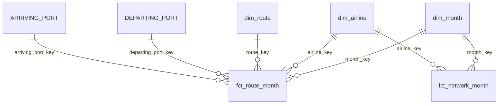

# Power BI build guide

How to turn the warehouse into a Power BI report on Windows, with the same numbers as the dbt metrics. Allow about an hour for the first build.

Everything Power BI needs is in this folder:

| File | What it is |
|---|---|
| [`data/*.parquet`](data) | The star schema: 2 facts, 4 dimensions and the comparison periods (2.5 MB). Written by `scripts/export_powerbi.py`, which reads each file back and checks it against the warehouse. |
| [`data/MANIFEST.json`](data/MANIFEST.json) | Row count, column types, null counts and column totals for every file. |
| [`measures.dax`](measures.dax) | Every measure, plus 7 check queries. Paste it into DAX query view. |
| [`CHECKS.md`](CHECKS.md) | What the check queries should return. A test checks every value against the dbt metrics models. |

> **Status:** the DAX mirrors `warehouse/macros/otp_metrics.sql` and is checked by tests (every measure it uses is defined, the tables and columns exist in the export, the volume floor matches dbt). It hasn't been run inside Power BI yet, because Power BI Desktop only runs on Windows. The check queries in step 5 confirm it on the first build.

## 1. Before you start

- Install **Power BI Desktop** (free, from the Microsoft Store).
- Get the repo: `git clone https://github.com/nisha1324/airline-ontime-dbt-warehouse`, or download the ZIP from GitHub. Python isn't needed: the Parquet files are committed.
- In Power BI: **File → Options and settings → Options → Current file → Data load**, untick **Auto date/time** (it would add a hidden calendar for every date column; this model has its own month table) and untick **Autodetect new relationships after data is loaded** (it would guess joins from column names; step 3 sets them explicitly).

## 2. Load the tables (Power Query)

1. **Home → Transform data** opens Power Query.
2. **Home → Manage parameters → New parameter:** name `DataFolder`, type **Text**, current value the full path to `powerbi\data\` with a trailing backslash, e.g. `C:\Users\you\airline-ontime-dbt-warehouse\powerbi\data\`.
3. For each table below: **Home → New source → Blank query**, open **Advanced editor**, paste, and rename the query to the name in the table.

```powerquery
let
    Source = Parquet.Document(File.Contents(DataFolder & "fct_route_month.parquet"))
in
    Source
```

| Query name | File | Rows | One row per… |
|---|---|---|---|
| `fct_route_month` | `fct_route_month.parquet` | 87,176 | airline × directional route × month (listed routes) |
| `fct_network_month` | `fct_network_month.parquet` | 1,918 | airline × month (whole network) |
| `dim_airline` | `dim_airline.parquet` | 17 | airline, with `brand_family` |
| `dim_route` | `dim_route.parquet` | 162 | directional route, with city pair |
| `dim_month` | `dim_month.parquet` | 273 | month, with Australian financial year |
| `dim_comparison_period` | `dim_comparison_period.parquet` | 3 | named comparison window |
| `Departing Port` | `dim_port.parquet` | 45 | port, in its departing role |
| `Arriving Port` | `dim_port.parquet` | 45 | port, in its arriving role |

`dim_port` is loaded **twice**, once per role (see step 3). Keep the column names as they are: the DAX uses them.

4. Check the types Power Query picked up from the Parquet schema: text → **Text**, integers → **Whole number**, dates → **Date**, booleans → **True/False**, and every flight count → **Decimal number**. Don't change the flight counts to Whole number: 28 of the exported fact rows (26 route, 2 network) have fractional counts as published (2009 and 2011), and rounding them would break the totals in `MANIFEST.json`.
5. **Close & Apply.**

## 3. Relationships (Model view)

Create exactly these seven, all **many-to-one, single direction, active**:

| From (many side) | To (one side) |
|---|---|
| `fct_route_month[month_key]` | `dim_month[month_key]` |
| `fct_route_month[airline_key]` | `dim_airline[airline_key]` |
| `fct_route_month[route_key]` | `dim_route[route_key]` |
| `fct_route_month[departing_port_key]` | `'Departing Port'[port_key]` |
| `fct_route_month[arriving_port_key]` | `'Arriving Port'[port_key]` |
| `fct_network_month[month_key]` | `dim_month[month_key]` |
| `fct_network_month[airline_key]` | `dim_airline[airline_key]` |



`dim_comparison_period` has **no relationships** on purpose (see step 4). Nothing joins the two facts to each other: they're different grains.

**Why two port tables instead of one with an inactive relationship?** Power BI allows only one active relationship between two tables. With one `dim_port`, the arriving-port relationship would have to be inactive, so a slicer on port could only ever filter departures, and every arrival measure would need a `USERELATIONSHIP` copy. Two small tables (45 rows each) give report users a "Departing Port" slicer and an "Arriving Port" slicer that both just work, e.g. everything from Sydney to Queensland.

**Why not "Mark as date table"?** Power BI's date table check needs one row per day with no gaps; `dim_month` has one row per month. It doesn't need it: the rolling and period measures filter `month_start` and `month_key` directly, so no time-intelligence functions are used. Sort the text columns instead (Column tools → **Sort by column**):

| Column | Sort by |
|---|---|
| `dim_month[month_label]` | `month_key` |
| `dim_month[month_name]` | `month_num` |
| `dim_month[financial_year_label]` | `financial_year` |
| `dim_comparison_period[period_label]` | `sort_order` |

Then hide what report users shouldn't drag onto a visual: every `*_key` and `*_id` column, and every numeric column of the two facts (the measures replace them). A raw `sectors_scheduled` dragged onto a visual is summed without the rules below.

## 4. Measures (DAX query view)

1. Open **DAX query view** (its icon is in the bar on the left, after Report, Table and Model view).
2. Paste all of [`measures.dax`](measures.dax) and click **Run**. The check queries run with the measures defined in the query only.
3. Click **Update model with changes**: it adds every measure to its table.
4. In Model view, set formats: the `%` measures → **Percentage, 1 decimal place** (2 while you check against `CHECKS.md`); the flight counts → **Whole number with thousands separator**. Optionally group them with **Display folder**: `Network`, `Route`, `Period`, `Rolling`.

If your version has no DAX query view, add each one with **New measure** and paste the part after `MEASURE table[`, i.e. `Name = expression`.

The measures follow the same rules as the warehouse:

| Rule | Why it matters | In the DAX |
|---|---|---|
| Rates are ratios of sums | An average of route percentages weights a 30-flight route the same as a 5,000-flight one | `DIVIDE ( [Arrivals On Time], [Flights Flown] )`, never `AVERAGE` of a rate |
| Airline and national figures come from `fct_network_month` | The route fact covers only listed routes (~76% of flights) | `Flights Scheduled`, `On-time Arrival %`… vs `Route Flights Scheduled`, `Route On-time Arrival %`… |
| Missing cancellation counts leave both sides | 316 route rows (Qantas Group, 2006–07) have none; counting them as zero makes those airlines look more reliable | `Cancellation Base` sums scheduled flights where `NOT ISBLANK ( cancellations )` (not `= BLANK()`: in DAX `0 = BLANK()` is true) |
| Rolling 12 months is a ratio of 12-month sums | Smooths seasonality without averaging percentages | `Rolling 12m On-time Arrival %`; blank until 12 months exist |
| Periods are filters on month, not a relationship | FY2018-19 sits inside the long run, so the periods overlap | `Period …` measures read the selected period with `SELECTEDVALUE` |
| League tables use a volume floor | A few bad days on a thin route shouldn't top a table | `Period Meets Floor` / `Period Route Meets Floor`: ≥ 300 flights a month on average, the same as `ranking_min_flights_per_month` in dbt |

The `Period …` measures are blank unless exactly one period is in context: use `dim_comparison_period[period_label]` as a single-select slicer, or on the rows or columns of a matrix.

## 5. Check the numbers

Run the 7 `EVALUATE` queries at the end of `measures.dax` (still in DAX query view; pick a result from the drop-down) and compare with [`CHECKS.md`](CHECKS.md). They cover the national rates per period, the rolling window (including the record low of 67.46% in the 12 months to Mar 2023), the brand families, Brisbane–Melbourne by airline, the airports above the floor, the missing-cancellations trap and the grand totals.

If something doesn't match:

- **Everything is off:** a relationship is missing or points the wrong way. Model view should show exactly the seven in step 3.
- **Route or airport rates are off but national is right:** check the `Departing Port` / `Arriving Port` relationships and that `dim_route` joins on `route_key`.
- **Only the FY2006-07 cancellation check is off:** `cancellations` was loaded as Whole number with nulls replaced by 0, or `Cancellation Base` was changed to `= BLANK()`.
- **Totals are slightly off:** a flight-count column was changed to Whole number.

## 6. Report pages

Four pages, one per business question from the README. Put a single-select **period slicer** (`period_label`) on pages 1–3.

| Page | Question | Visuals |
|---|---|---|
| **1. Overview** | Has reliability recovered since COVID? | Cards: `Period Flights Scheduled`, `Period On-time Arrival %`, `Period Cancellation %`. Line chart: `month_start` on the x-axis, `Rolling 12m On-time Arrival %` (and `Rolling 12m Cancellation %` on a secondary axis), from Dec 2004. |
| **2. Airlines** | Which airlines run on time? | Clustered bar: `brand_family` by `Period On-time Arrival %`, visual filter `Period Meets Floor` = True. Matrix: `brand_family` × `period_label` with `Period On-time Arrival %` and `Period Cancellation %` (the FY2018-19 vs latest comparison). |
| **3. Same route** | Which airline should we book on this route? | Slicer: `dim_route[city_pair_name]`. Bar: `brand_family` by `Period Route On-time Arrival %`, tooltip `Period Route Flights Scheduled` and `Period Route Cancellation %`. This is the page behind the "preferred carrier by route" recommendation. |
| **4. Routes and airports** | Where is it worst? | Table: `city_pair_name`, `Period Route On-time Arrival %`, `Period Route Cancellation %`, `Period Route Flights Scheduled`, filtered to `Period Route Meets Floor` = True, sorted worst first. Table: `'Departing Port'[port_name]` and `state` with `Period Route On-time Departure %`. Slicers: `'Departing Port'[state]`, `'Arriving Port'[state]`. |

Add a text box on page 1 with the definitions: on time = within 15 minutes of schedule; cancellation = removed within 7 days of departure; route and airport pages cover only BITRE's listed competitive routes.

## 7. Save and share

- Save as `powerbi/airline_ontime.pbix`. (If the Power BI Project preview feature is turned on, saving as `.pbip` instead stores the model as text files, which show up better in git diffs.)
- Export a screenshot of each page to `powerbi/screenshots/` (PNG) so the README can show the report without Power BI.

## Refreshing with a newer BITRE month

```bash
python scripts/download_data.py --update   # new snapshot
python scripts/build.py                    # dbt build + tests
python scripts/export_powerbi.py           # Parquet + manifest, read back and checked
python scripts/powerbi_checks.py           # new CHECKS.md
```

Then **Home → Refresh** in Power BI. The latest-12-months period moves forward by itself (`dim_comparison_period` is rebuilt from the data).
