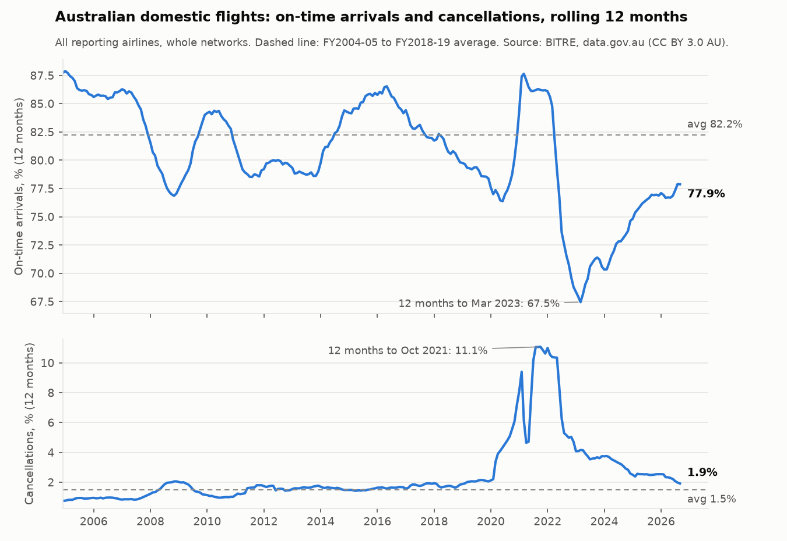
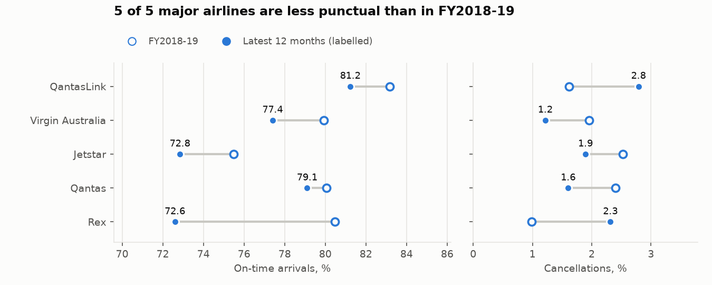
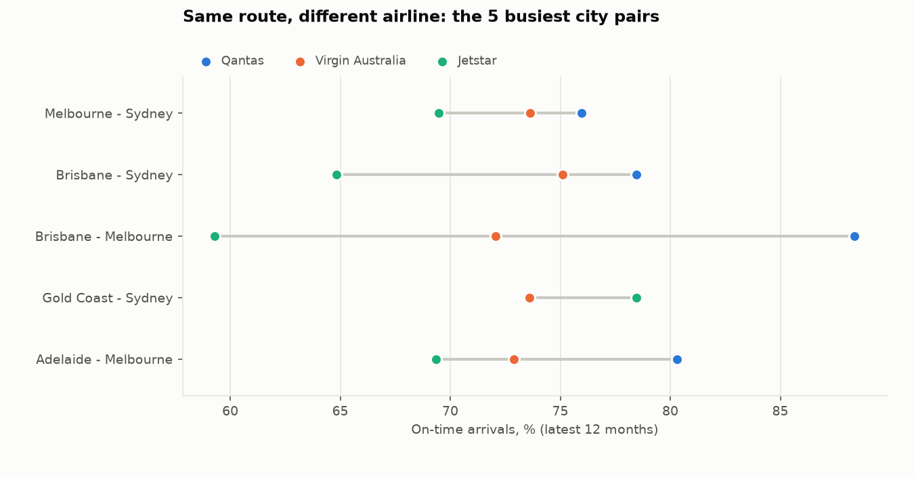
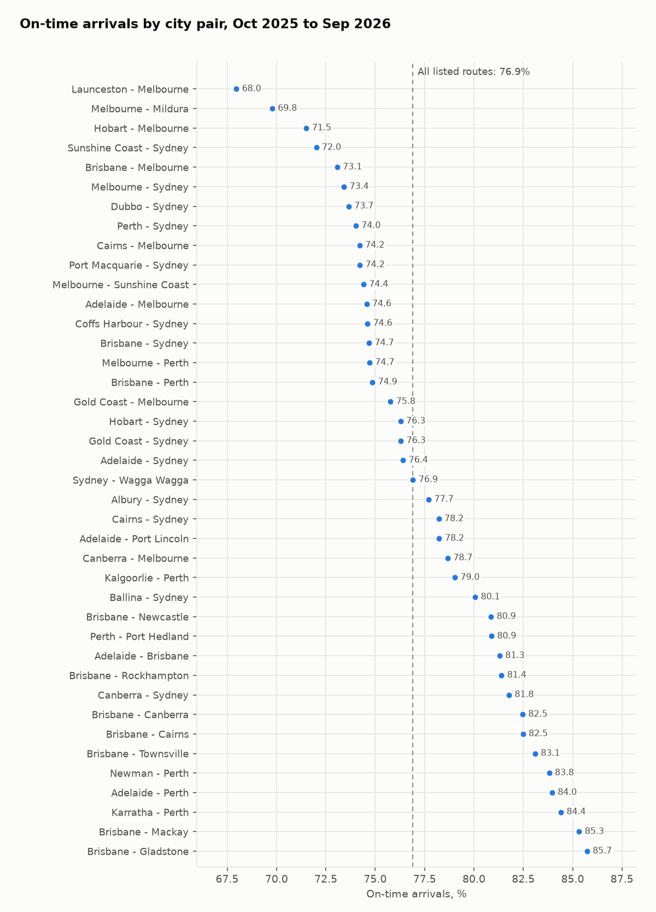

# Metrics and business answers

*Generated by `scripts/analyse.py` from the dbt metrics models in `data/warehouse.duckdb`.
Do not edit by hand.*

## Metric definitions

Defined once in [`warehouse/macros/otp_metrics.sql`](../warehouse/macros/otp_metrics.sql) and
used by every metrics model. Each rate is a **ratio of sums**: counts are added up first and
divided once, so a 30-flight route doesn't weigh as much as a 5,000-flight one.

| Metric | Formula (BITRE's definitions) | Notes |
|---|---|---|
| On-time arrival rate | arrivals on time ÷ sectors flown | on time = at the gate < 15 min after schedule |
| On-time departure rate | departures on time ÷ sectors flown | the headline for airports |
| Cancellation rate | cancellations ÷ sectors scheduled | rows with no cancellation count (316, 2006–2007) leave both sides |

Periods: **FY2004-05 to FY2018-19** (long-run, pre-COVID), **FY2018-19**
(the last full year before COVID) and the **latest 12 months, Oct 2025 to Sep 2026**. League tables only
rank a route, airport or airline-on-route with at least 300 scheduled flights a month on average
(about 10 a day; `ranking_min_flights_per_month` in `dbt_project.yml`).

## 1. National: has reliability recovered since COVID?

| Period | Flights scheduled | On-time arrivals | On-time departures | Cancellations |
|---|---|---|---|---|
| FY2004-05 to FY2018-19 | 7,908,968 | 82.2% | 83.6% | 1.50% |
| FY2018-19 | 563,834 | 79.4% | 80.6% | 2.05% |
| Oct 2025 to Sep 2026 | 546,792 | 77.9% | 78.7% | 1.92% |

- **Punctuality hasn't recovered.** 77.9% of flights arrived on time in the latest
  12 months, vs 79.4% in FY2018-19 and 82.2% on average over the 15 years before
  COVID (-4.4 pts).
- **It has climbed back from a record low.** The 12 months to Mar 2023 were the least punctual
  in the series at 67.5%; the worst 12 months before 2020 ended Nov 2008, at 76.9%.
- **Cancellations.** 1.92% in the latest 12 months:
  below FY2018-19's 2.05% and
  above the long-run 1.50%. They peaked at
  11.08% in the 12 months to Oct 2021 (COVID lockdowns and border closures).
- Volume is close to pre-COVID: 546,792 flights scheduled in the latest 12 months vs 563,834 in
  FY2018-19 (-3.0%).

| Financial year | Flights scheduled | On-time arrivals | Cancellations | Months |
|---|---|---|---|---|
| FY2018-19 | 563,834 | 79.4% | 2.05% | 12 |
| FY2019-20 | 437,049 | 76.4% | 4.34% | 12 |
| FY2020-21 | 268,227 | 86.1% | 7.59% | 12 |
| FY2021-22 | 365,918 | 76.8% | 8.31% | 12 |
| FY2022-23 | 528,982 | 69.5% | 3.74% | 12 |
| FY2023-24 | 554,039 | 72.6% | 3.38% | 12 |
| FY2024-25 | 549,086 | 76.3% | 2.53% | 12 |
| FY2025-26 | 551,041 | 76.9% | 2.22% | 12 |
| FY2026-27 | 137,647 | 79.5% | 1.31% | 3 |

The latest financial year is partial (months column).

## 2. Airlines: who runs on time?

Whole networks, by brand family (Regional Express and Rex Airlines are one family). The chart
shows the brands above the volume floor in both periods.

| Brand family | Flights, latest 12m | Share | On time FY19 | On time latest | Change | Cancelled FY19 | Cancelled latest |
|---|---|---|---|---|---|---|---|
| QantasLink | 149,373 | 27.3% | 83.2% | 81.2% | -1.9 pts | 1.62% | 2.79% |
| Virgin Australia | 141,581 | 25.9% | 79.9% | 77.4% | -2.5 pts | 1.96% | 1.22% |
| Jetstar | 96,437 | 17.6% | 75.5% | 72.8% | -2.6 pts | 2.52% | 1.89% |
| Qantas | 83,350 | 15.2% | 80.1% | 79.1% | -1.0 pts | 2.40% | 1.60% |
| Rex | 50,969 | 9.3% | 80.5% | 72.6% | -7.9 pts | 0.99% | 2.32% |
| Hinterland | 18,977 | 3.5% | – | 91.1% | – | – | 0.56% |
| Skytrans Australia | 3,200 | 0.6% | – | 72.4% | – | – | 3.41% |
| Virgin Australia Regional Airlines | 1,942 | 0.4% | 74.0% | 70.1% | -3.9 pts | 2.13% | 1.24% |
| SmartLynx Australia | 963 | 0.2% | – | 76.9% | – | – | 2.60% |
| Tigerair Australia | – | – | 68.1% | – | – | 4.29% | – |

- **5 of 5** major brands are less punctual than in FY2018-19, and **3 of 5** cancel
  a smaller share of flights. Brands above the floor in only one period are in the table, not the chart.
- Network-level comparisons mix in **where** an airline flies: QantasLink and Hinterland fly
  mostly regional routes, Jetstar is leisure-heavy. The fair comparison is on the same route.

## 3. Same route, different airline

On the 5 busiest city pairs (Oct 2025 to Sep 2026, both directions), the gap between the
most and least punctual airline on the same route is 4.9 to 29.1 points.
Between the five routes themselves (all airlines together) it is 3.2 points.
So the airline you book matters more than which of these routes you fly.

| City pair | Most punctual | Least punctual | Gap |
|---|---|---|---|
| Melbourne - Sydney | Qantas 76.0% | Jetstar 69.5% | 6.5 pts |
| Brisbane - Sydney | Qantas 78.5% | Jetstar 64.8% | 13.6 pts |
| Brisbane - Melbourne | Qantas 88.4% | Jetstar 59.3% | 29.1 pts |
| Gold Coast - Sydney | Jetstar 78.5% | Virgin Australia 73.6% | 4.9 pts |
| Adelaide - Melbourne | Qantas 80.3% | Jetstar 69.3% | 11.0 pts |

| City pair | Brand family | Flights | Share of pair | On time | Cancelled | Ranked |
|---|---|---|---|---|---|---|
| Adelaide - Melbourne | Qantas | 5,667 | 35.0% | 80.3% | 0.81% | yes |
| Adelaide - Melbourne | Virgin Australia | 6,078 | 37.5% | 72.9% | 1.18% | yes |
| Adelaide - Melbourne | QantasLink | 622 | 3.8% | 70.1% | 3.70% | below floor |
| Adelaide - Melbourne | Jetstar | 3,826 | 23.6% | 69.3% | 1.70% | yes |
| Brisbane - Melbourne | Qantas | 6,536 | 27.1% | 88.4% | 1.01% | yes |
| Brisbane - Melbourne | Virgin Australia | 10,002 | 41.4% | 72.1% | 0.92% | yes |
| Brisbane - Melbourne | QantasLink | 3,147 | 13.0% | 63.0% | 6.64% | below floor |
| Brisbane - Melbourne | Jetstar | 4,470 | 18.5% | 59.3% | 3.27% | yes |
| Brisbane - Sydney | Qantas | 12,375 | 43.3% | 78.5% | 2.25% | yes |
| Brisbane - Sydney | Virgin Australia | 10,908 | 38.1% | 75.1% | 1.42% | yes |
| Brisbane - Sydney | Jetstar | 5,313 | 18.6% | 64.8% | 4.44% | yes |
| Gold Coast - Sydney | Qantas | 3,182 | 19.5% | 78.5% | 0.00% | below floor |
| Gold Coast - Sydney | Jetstar | 5,907 | 36.1% | 78.5% | 2.10% | yes |
| Gold Coast - Sydney | Virgin Australia | 7,262 | 44.4% | 73.6% | 0.55% | yes |
| Melbourne - Sydney | Qantas | 19,118 | 38.5% | 76.0% | 3.59% | yes |
| Melbourne - Sydney | Virgin Australia | 17,718 | 35.6% | 73.6% | 3.21% | yes |
| Melbourne - Sydney | Jetstar | 12,004 | 24.1% | 69.5% | 4.17% | yes |
| Melbourne - Sydney | QantasLink | 867 | 1.7% | 66.3% | 7.84% | below floor |

Airlines under the floor (about 10 flights a day) are listed but not ranked or charted.

## 4. Routes: the worst and best

40 of the 60 listed city pairs clear the volume floor. Across them, all airlines
together arrived on time on 76.9% of listed-route flights (national, all routes:
77.9%). "Months below national" counts the months a city pair ran under
that month's national rate: a check that a ranking isn't one bad month.

**Least punctual**

| City pair | Flights | On time | Cancelled | Months below national |
|---|---|---|---|---|
| Launceston - Melbourne | 7,254 | 68.0% | 2.80% | 12 of 12 |
| Melbourne - Mildura | 4,303 | 69.8% | 2.65% | 12 of 12 |
| Hobart - Melbourne | 9,754 | 71.5% | 0.76% | 12 of 12 |
| Sunshine Coast - Sydney | 5,553 | 72.0% | 1.10% | 11 of 12 |
| Brisbane - Melbourne | 24,155 | 73.1% | 2.12% | 11 of 12 |

**Most punctual**

| City pair | Flights | On time | Cancelled | Months below national |
|---|---|---|---|---|
| Brisbane - Gladstone | 3,888 | 85.7% | 2.88% | 0 of 12 |
| Brisbane - Mackay | 7,986 | 85.3% | 1.43% | 0 of 12 |
| Karratha - Perth | 6,375 | 84.4% | 1.22% | 0 of 12 |
| Adelaide - Perth | 4,891 | 84.0% | 0.49% | 0 of 12 |
| Newman - Perth | 4,469 | 83.8% | 0.49% | 2 of 12 |

**Most cancellations**

| City pair | Flights | On time | Cancelled | Months below national |
|---|---|---|---|---|
| Canberra - Sydney | 14,419 | 81.8% | 4.99% | 0 of 12 |
| Adelaide - Port Lincoln | 5,938 | 78.2% | 4.80% | 6 of 12 |
| Port Macquarie - Sydney | 4,151 | 74.2% | 4.31% | 8 of 12 |
| Melbourne - Sydney | 49,707 | 73.4% | 3.67% | 11 of 12 |
| Dubbo - Sydney | 4,963 | 73.7% | 3.57% | 8 of 12 |

- Late and cancelled are different problems: the rank correlation between a city pair's
  on-time rate and its cancellation rate is **-0.15**. Canberra - Sydney cancels the most
  (4.99%) yet ranks 9 of 40 for punctuality.
- **Floor sensitivity.** At a floor of 100 flights a month (55 city pairs), the least
  punctual five gain Hamilton Island - Sydney (64.5%, 1,474 flights);
  the most punctual five gain Brisbane - Emerald (89.3%, 3,400 flights), Adelaide - Canberra (87.2%, 2,802 flights), Brisbane - Mount Isa (87.0%, 1,675 flights), Broome - Perth (85.6%, 3,510 flights).

**Recovery by route.** 29 of the 38 city pairs ranked in both periods are less punctual
than in FY2018-19. Largest falls and largest gains:

| City pair | On time FY19 | On time latest | Change | Cancelled FY19 | Cancelled latest |
|---|---|---|---|---|---|
| Adelaide - Port Lincoln | 89.8% | 78.2% | -11.5 pts | 1.07% | 4.80% |
| Melbourne - Mildura | 80.6% | 69.8% | -10.8 pts | 1.04% | 2.65% |
| Kalgoorlie - Perth | 88.6% | 79.0% | -9.6 pts | 1.60% | 2.08% |
| Launceston - Melbourne | 75.9% | 68.0% | -7.9 pts | 1.01% | 2.80% |
| Coffs Harbour - Sydney | 80.7% | 74.6% | -6.1 pts | 1.31% | 2.47% |
| Hobart - Melbourne | 70.2% | 71.5% | +1.3 pts | 1.29% | 0.76% |
| Canberra - Sydney | 79.2% | 81.8% | +2.5 pts | 2.86% | 4.99% |
| Adelaide - Perth | 80.8% | 84.0% | +3.1 pts | 0.99% | 0.49% |

## 5. Airports: on-time departures

Departing port, over the listed routes that leave it (15 of 38 ports clear the floor;
smaller ports are in `met_departing_port_period`).

| Departing port | State | Departures | Routes | On-time departures | FY19 | Change | Cancelled |
|---|---|---|---|---|---|---|---|
| Sunshine Coast | QLD | 5,128 | 2 | 69.5% | 66.9% | +2.6 pts | 0.92% |
| Launceston | TAS | 5,405 | 3 | 70.3% | 76.9% | -6.7 pts | 2.41% |
| Hobart | TAS | 8,941 | 3 | 72.2% | 72.0% | +0.3 pts | 1.06% |
| Gold Coast | QLD | 15,868 | 4 | 73.5% | 73.8% | -0.3 pts | 1.10% |
| Melbourne | VIC | 81,838 | 15 | 75.3% | 78.7% | -3.4 pts | 2.16% |
| Sydney | NSW | 90,371 | 18 | 76.5% | 77.2% | -0.7 pts | 2.53% |
| Cairns | QLD | 9,871 | 3 | 78.3% | 81.4% | -3.2 pts | 0.73% |
| Adelaide | SA | 26,988 | 8 | 78.8% | 82.9% | -4.1 pts | 1.89% |
| Brisbane | QLD | 66,359 | 18 | 79.6% | 83.0% | -3.4 pts | 1.46% |
| Newcastle | NSW | 4,408 | 2 | 80.2% | 80.2% | -0.1 pts | 0.75% |
| Canberra | ACT | 17,057 | 5 | 80.6% | 82.7% | -2.1 pts | 3.63% |
| Townsville | QLD | 4,361 | 1 | 81.6% | 85.2% | -3.5 pts | 1.72% |
| Rockhampton | QLD | 3,922 | 1 | 82.1% | 83.6% | -1.5 pts | 1.96% |
| Perth | WA | 30,606 | 10 | 82.7% | 83.8% | -1.1 pts | 0.92% |
| Mackay | QLD | 4,018 | 1 | 86.2% | 86.5% | -0.3 pts | 1.64% |

The least punctual departure points are Sunshine Coast (69.5%) and Launceston
(70.3%); the most punctual is Mackay (86.2%). Least punctual city pair:
Launceston - Melbourne (68.0%); most punctual: Brisbane - Gladstone (85.7%).
